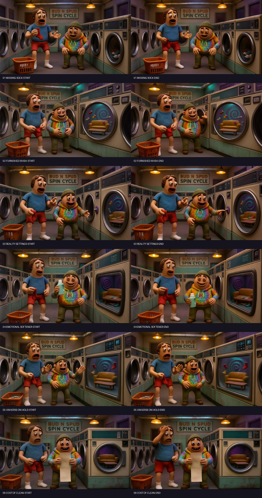
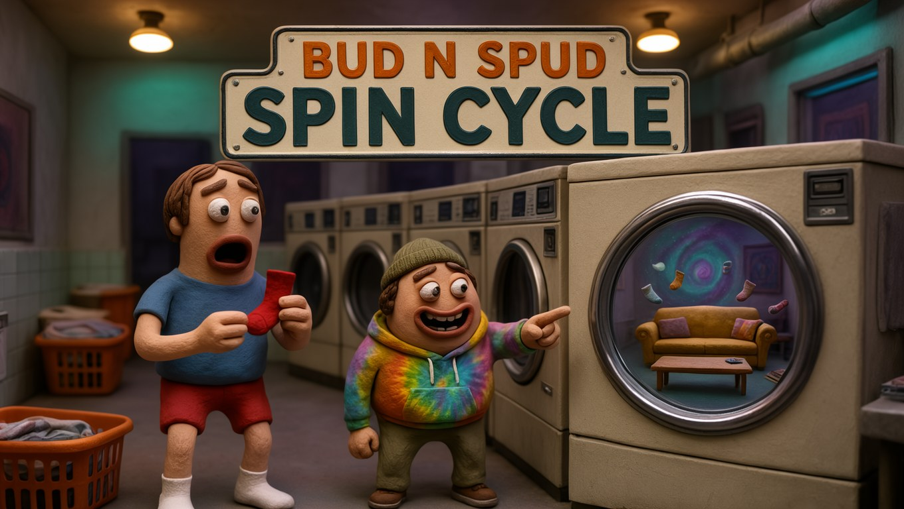

# Bud n Spud Creator TV

**An open, creator-led ComfyUI production pipeline for making recurring-character episodes.** Bud n Spud combines custom fine-tuned FLUX Klein LoRAs, image editing, two synthetic voice references, MiniMax H3 video, and a repeatable scene-by-scene workflow. Hermes Agent can help plan and coordinate the process; the included browser workbench is an optional prototype, not a prerequisite or a claim of fully autonomous production.



*Spin Cycle: six actual generated starting and ending reference images from the laundromat production. These are reference images, not guaranteed video frame locks. [Browse every image](assets/gallery/).*

## The pipeline

1. **Create the look:** use our [custom fine-tuned Chaos Scene LoRA](https://huggingface.co/TheMindExpansionNetwork/budnspud-chaos-scene-lora-v1) with the relevant FLUX Klein workflow to generate character scenes.
2. **Develop each shot:** create a start image and use our [custom fine-tuned Next-Scene Edit LoRA](https://huggingface.co/TheMindExpansionNetwork/budnspud-next-scene-edit-flux3_klein_v1) to propose a later state. Review for continuity.
3. **Prepare five references:** starting frame, ending-state image, background image, and two distinct synthetic voice reference clips. Describe each character, scene action and dialogue in the prompt.
4. **Generate video:** run the H3 OmniRef workflow in a compatible ComfyUI environment. References guide the result; they do not hard-lock frames, voices, speech or lip sync.
5. **Finish and review:** assemble scene clips, add music and transitions, then review image continuity, speech, rights and audio. The previous Spin Cycle film used this overall approach; voice similarity, extra or garbled words and visual drift remain real limitations.
6. **Coordinate with Hermes:** provide the brief, references, prompts and workflows to an agent to help organize production and preserve records. Human review remains essential.



### Scene references

| Scene | Starting image | Later-state image |
|---|---|---|
| 1. Missing sock | [Start](assets/gallery/01_missing_sock-start.jpg) | [End](assets/gallery/01_missing_sock-end.jpg) |
| 2. Furnished wash | [Start](assets/gallery/02_furnished_wash-start.jpg) | [End](assets/gallery/02_furnished_wash-end.jpg) |
| 3. Reality settings | [Start](assets/gallery/03_reality_settings-start.jpg) | [End](assets/gallery/03_reality_settings-end.jpg) |
| 4. Emotional softener | [Start](assets/gallery/04_emotional_softener-start.jpg) | [End](assets/gallery/04_emotional_softener-end.jpg) |
| 5. Universe on hold | [Start](assets/gallery/05_universe_on_hold-start.jpg) | [End](assets/gallery/05_universe_on_hold-end.jpg) |
| 6. Cost of clean | [Start](assets/gallery/06_cost_of_clean-start.jpg) | [End](assets/gallery/06_cost_of_clean-end.jpg) |

The images are compressed gallery copies of the production references. The underlying sets and poses vary; they are examples, not continuity guarantees. Their creative rights are separate from the MIT code license; see [rights and models](docs/RIGHTS_AND_MODELS.md).

**Demo:** Not published yet.  
**Contest submission:** [Draft and release checklist](SUBMISSION.md)

## What's here

- A local browser workbench in [`app/`](app/) for scene direction, reference selection and production/graph exports. See the in-app labels for exactly which inputs are wired to its current graph; functionality may change as the prototype develops.
- Three starter images: [start](assets/images/start.png), [later state](assets/images/end.png), and [background](assets/images/background.png); plus two synthetic voice auditions: [left](assets/voices/left.wav) and [right](assets/voices/right.wav). The [reference sheet](assets/images/reference-sheet.jpg) shows the images together.
- [Supplied and historically executed API graphs](workflows/), with [prompts and execution notes](docs/WORKFLOWS_AND_PROMPTS.md). These are API-format graphs, not GUI workflow exports; some supplied graphs contain stock prompts and filenames.
- A workflow suitable for **Hermes-assisted** planning and operation: an operator can ask Hermes to inspect the briefs and graphs, prepare prompts and help coordinate execution on an authorized environment. Hermes is not bundled as an autonomous always-on broadcaster, and this repository does not establish unattended end-to-end automation.

## Try the workbench

With Python 3 installed, from the repository root:

```sh
python3 app/server.py
```

Open <http://127.0.0.1:8765/>. Enter scene direction, select references and use the available exports. Selected files and graph inputs are distinct: inspect the UI and the resulting graph instead of assuming that every selected item is passed to the model. Export before closing the page. The app and backend are under active development; consult their current implementation and test results before relying on submission or rendering features.

For manual generation, use a compatible ComfyUI installation, required custom nodes and separately obtained models. Upload or place inputs where that runtime expects them, update the historical filenames and model selections in the API graph, then submit it through a compatible API client. For the recorded three-image/two-audio graph, consult [the node map and prompt](docs/WORKFLOWS_AND_PROMPTS.md) and [voice provenance](docs/ASSETS_AND_PROVENANCE.md). Model weights, a running GPU server and credentials are not included.

## Cloud versus self-hosted ComfyUI

| | Self-hosted ComfyUI | Comfy Cloud |
|---|---|---|
| Setup | You provide and secure the runtime, GPU, nodes, weights and inputs. Check each dependency's license and hardware requirements. | Hosted service, account and applicable credits/plan. Check its current supported nodes, models, upload options and limits.[2] |
| This project | API graphs are examples to inspect and adapt for a compatible installation; successful execution on your setup is not guaranteed. | **No Comfy Cloud integration is established here.** Importing or adapting these API graphs for Cloud is a manual experiment, not a verified supported path. Verify graph format, all nodes, model availability, inputs, and an actual runtime execution before claiming compatibility.[2] |
| H3 licensing | MiniMax's H3 Community License excludes the US, EU, UK and Republic of Korea from its applicable territory; seek separate authorization where required and read all conditions.[1] | Comfy states that Cloud subscriptions include commercial rights to generated outputs and distinguishes this from licensing H3 locally.[3] Check the actual service terms, your plan, third-party inputs and the rights in your specific outputs; Cloud use does not grant a local model license or rights to creator IP. |

Cloud availability, pricing and policies can change. The Cloud product page says not all custom nodes are supported.[2] Never expose an unprotected self-hosted ComfyUI server to the public internet or put credentials in an exported graph.

## Honest generation limits

Images and audio are **references, not locks**: they do not guarantee exact first/last frames, character identity, speech, voice identity or lip sync. The included historical H3 graph used an earlier pair of voice files, not the two WAVs in this kit. The historical output is not included; its retained run record describes a completed clip, but automated transcription flagged possible additional utterances. Human listening, speaker attribution and lip sync were not verified. See [provenance](docs/ASSETS_AND_PROVENANCE.md). A new run with the included voice auditions is an experiment, not a reproduction of that output.

## Rights and model dependencies

Project **code** is available under the [MIT License](LICENSE). Artwork, character names and likenesses, audio, generated media and other creative assets are separate: rights are retained by the creator, and publication here does not grant a blanket reuse license. Third-party workflow components, models and weights retain their own terms. Obtain permission where needed.

The creator's [Chaos Scene LoRA](https://huggingface.co/TheMindExpansionNetwork/budnspud-chaos-scene-lora-v1) and [Next-Scene Edit LoRA](https://huggingface.co/TheMindExpansionNetwork/budnspud-next-scene-edit-flux3_klein_v1) are public links, not bundled weights; their model cards did not declare a license when checked for this kit. Public access is not blanket reuse permission. See [rights and models](docs/RIGHTS_AND_MODELS.md), including Fish Audio terms and attribution: **Built with Fish Audio**. This is an operational guide, not legal advice.

## Sources

[1] https://huggingface.co/MiniMaxAI/MiniMax-H3/blob/main/LICENSE
[2] https://comfy.org/cloud
[3] https://comfy.org/minimax/license
